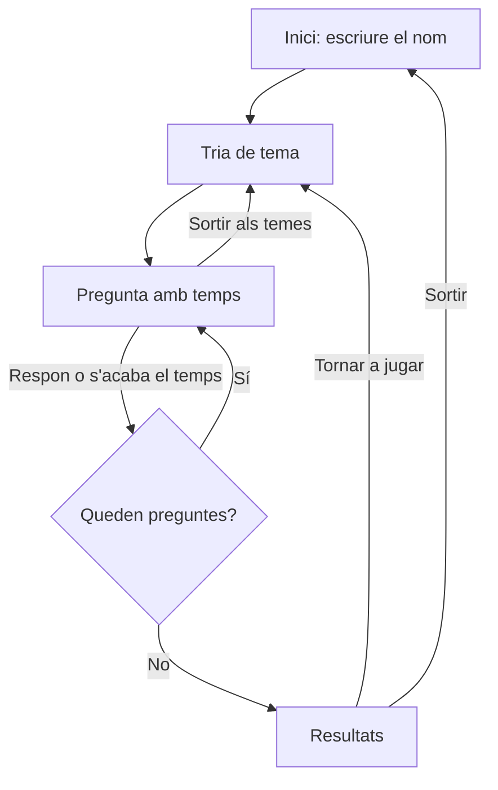

# Joc Quiz

Joc de preguntes tipus Trivial fet amb HTML, CSS i JavaScript.
Projecte del mòdul M010 – CFGS DAM.

## Equip

| Membre | Rol |
|---|---|
| Anthony Milla | Responsable de GitHub + pantalles d'inici, tria de tema, resultats i avís d'encert |
| Biel Pérez | Disseny UI + lògica del joc (preguntes, respostes i temporitzador) |

## Com jugar
1. Obre `index.html` al navegador (no cal instal·lar res).
2. Escriu el teu nom i prem **Començar**.
3. Tria un tema: **Esports**, **Menjar**, **Geografia** o **Videojocs**.
4. Respon cada pregunta abans que s'acabi el temps (15 segons). Pots clicar la resposta o prémer les tecles **A**, **B**, **C** o **D**.
5. Al final veuràs la teva puntuació i quines preguntes has encertat. Pots **tornar a jugar** o **sortir**.

## Funcionalitats
- 4 temes, cadascun amb el seu color.
- Cada partida tria 5 preguntes a l'atzar del tema escollit.
- Temporitzador circular que canvia de color (verd, groc i vermell) i batega els últims 5 segons.
- Avís visual en respondre: la resposta bona es posa verda i la fallada vermella.
- Barra de progrés amb una ratlleta per pregunta.
- Botó per sortir als temes durant la partida.
- Pantalla de resultats amb un anell que mostra el percentatge d'encerts.

## Estructura del projecte
```
joc-quiz/
├── index.html          (les 4 pantalles del joc)
├── css/
│   └── style.css       (disseny i colors de cada tema)
├── js/
│   ├── preguntes.js    (preguntes de cada tema)
│   └── script.js       (lògica del joc)
└── docs/
├── planificacio.md
├── actes.md
├── mockup.md
└── mockup.png
```

## Tecnologies
- HTML5, CSS3 (variables, Flexbox, Grid i animacions) i JavaScript.
- Font Poppins (Google Fonts) i icones de Lucide.
- Figma per al mockup.
- Git i GitHub (branques, pull requests, issues, Project i milestones).

## Branques
- `main`: versions estables (amb tags)
- `test`: proves abans de passar a main
- `biel` / `anthony`: branca de treball de cada membre

## Commits
Des del seguiment 2, cada commit i cada pull request comença amb la inicial de qui l'ha fet:
- `B - descripció`: Biel
- `A - descripció`: Anthony

## Versions
- `v1.0` – Seguiment 1 (12/11): joc complet amb 2 temes.
- `v1.1` – Seguiment 2 (26/11): disseny nou, 4 temes, temporitzador circular i avís d'encert.
- `v1.2` – Entrega final (03/12): 40 preguntes per tema, 5 a l'atzar per partida, responsive i codi comentat.

## Flux del joc


## Documentació
- [Planificació](docs/planificacio.md)
- [Actes de reunions](docs/actes.md)
- [Mockup](docs/mockup.md) i [disseny a
Figma](https://www.figma.com/design/dCIzYqw6S19VCHduVQUR9C)