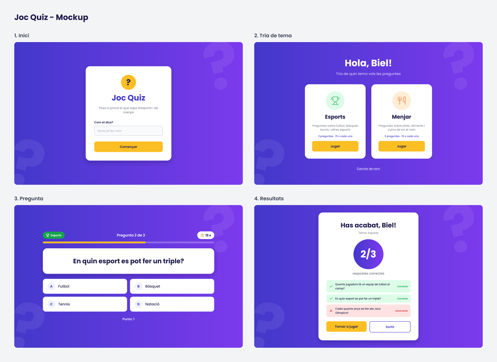

# Mockup - Joc Quiz

El mockup està fet amb Figma: [Joc Quiz - Mockup](https://www.figma.com/design/dCIzYqw6S19VCHduVQUR9C)

## Pantalles

| Pantalla | Què hi ha |
|---|---|
| 1. Inici | Logo, títol del joc, camp per escriure el nom i botó **Començar** |
| 2. Tria de tema | "Hola, [nom]!" i dues targetes per triar **Esports** o **Menjar** |
| 3. Pregunta | Tema, número de pregunta, temps que queda, la pregunta i 4 respostes (A, B, C, D) |
| 4. Resultats | Puntuació (per exemple 2/3), resum de cada pregunta i botons **Tornar a jugar** i **Sortir** |

## Tipografia

Fem servir la font **Poppins** de Google Fonts, amb 4 pesos: Regular (400), Medium (500), SemiBold (600) i Bold (700).

| Estil | Pes | Mida | On es fa servir |
|---|---|---|---|
| Display | Bold | 52 px | "Hola, [nom]!" i la puntuació final |
| Títol 1 | Bold | 44 px | Nom del joc |
| Títol 2 | Bold | 36 px | Text de la pregunta i títol de resultats |
| Títol 3 | Bold | 30 px | Nom de cada tema |
| Info | SemiBold | 20 px | "Pregunta X de Y" |
| Subtítol | Regular | 20 px | Text sota els títols |
| Opció | Medium | 20 px | Text de les respostes |
| Botó | SemiBold | 18 px | Text dels botons |
| Cos | Regular | 16 px | Text normal i camp del nom |
| Etiqueta | SemiBold | 16 px | "Com et dius?" i etiquetes |
| Enllaç | Medium | 16 px | "Canviar de nom" (subratllat) |
| Petit | Medium | 14 px | Informació petita i resum de respostes |
| Mini | SemiBold | 13 px | "Correcta" / "Incorrecta" |

## Colors

Al CSS, els colors estan guardats com a variables a `:root` (fitxer `css/style.css`).

| Color | Codi | Variable CSS | On es fa servir |
|---|---|---|---|
| Lila fosc | `#4338CA` | `--lila-fosc` | Color principal, títols i inici del degradat |
| Lila | `#7C3AED` | `--lila` | Final del degradat del fons |
| Groc | `#FBBF24` | `--groc` | Botons principals i barra del temps |
| Text principal | `#1E1B4B` | `--text` | Text normal |
| Text secundari | `#6B7280` | `--gris` | Textos de suport |
| Blanc | `#FFFFFF` | - | Targetes i botons secundaris |
| Gris clar | `#F9FAFB` | `--gris-clar` | Fons del camp del nom |
| Lila clar | `#EEF2FF` | `--lila-clar` | Cercle de la lletra de les respostes |
| Verd | `#16A34A` | `--verd` | Tema Esports i respostes correctes |
| Vermell | `#DC2626` | `--vermell` | Errors i respostes incorrectes |
| Taronja | `#EA580C` | `--taronja` | Tema Menjar |

El fons de totes les pantalles és un **degradat horitzontal** de lila fosc (`#4338CA`) a lila (`#7C3AED`), amb uns interrogants grans i transparents de decoració.

## Components

- **Botó principal:** groc, text fosc, cantonades de 12 px. Per a l'acció important de cada pantalla (Començar, Jugar, Tornar a jugar).
- **Botó secundari:** blanc amb vora lila de 2 px. Per a les accions secundàries (Sortir).
- **Opció de resposta:** fons blanc, vora lila clar, cantonades de 16 px. Porta la lletra (A, B, C, D) dins d'un cercle.
- **Targeta:** fons blanc, cantonades de 24 px i una ombra suau. Conté el contingut de cada pantalla.

## Formes i espais

- **Cantonades:** 12 px (botons i camps), 16 px (respostes), 24 px (targetes) i rodones del tot per a les etiquetes.
- **Espais:** fem servir múltiples de 8 (8, 16, 24, 32 i 48 px).

## Icones

Icones de [Lucide](https://lucide.dev) amb traç de 2 px: copa (Esports), coberts (Menjar), rellotge (temps), check (correcta) i creu (incorrecta).

## Flux entre pantalles

- **Inici → Tria de tema:** en clicar Començar, si el nom no és buit.
- **Tria de tema → Pregunta:** en clicar Jugar en un dels dos temes.
- **Pregunta → Pregunta:** quan es respon o s'acaba el temps, si queden preguntes.
- **Pregunta → Resultats:** després de l'última pregunta.
- **Resultats → Tria de tema:** amb Tornar a jugar.
- **Resultats → Inici:** amb Sortir.
- **Tria de tema → Inici:** amb Canviar de nom.

## Mida

El disseny està pensat per a ordinador (1280 × 800 px), amb el contingut centrat i una amplada màxima de 960 px. La versió per a mòbil i tauleta es farà al seguiment 2.
